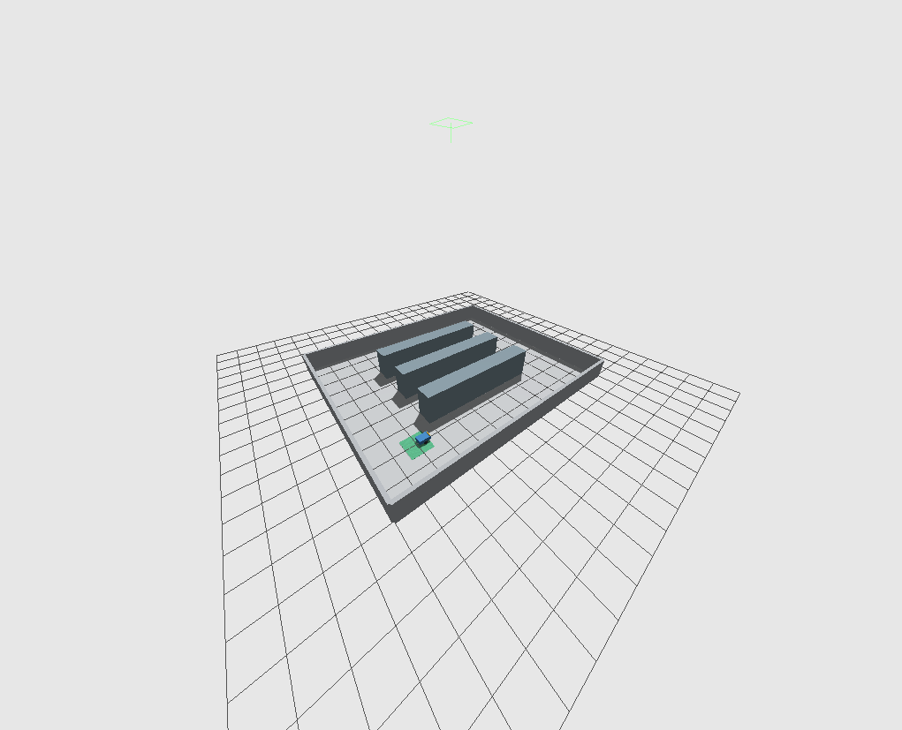

# Warehouse robot route optimization with ROS 2

Order-picking route optimization and replanning for a simulated warehouse mobile robot.

## Goal

The robot completes pickup jobs on a known aisle network and returns to the depot. The project examines route length and replanning after an aisle closure. Route length and robot execution time are evaluated separately.

## Planned features

- Warehouse layout, depot, and pickup jobs with unique identifiers.
- Comparison of FIFO, nearest-neighbor, and 2-opt pickup sequences.
- Robot motion and job execution with ROS 2 state feedback.
- Replanning from the current robot position after an aisle closure.
- Warehouse visualization, routes, job states, and measurement logs.
- Exact reference solutions for small cases and comparative evaluation for larger cases.

## Status

The warehouse world and differential-drive robot run in headless and graphical Gazebo modes. An odometry-based controller autonomously tracks a single goal and stops on arrival or feedback faults. A separate planner validates a static aisle graph and computes shortest graph routes. An aisle-route follower connects these components. Route-following validation passed the Humble build and 242 package tests. A measurement-based effective-track calibration now passes physical route gates in three fresh Gazebo runs each for the two original routes and a reserved route. [Calibration results and limits](docs/odometry-diagnostics.md) describe the tested simulation configuration. FIFO pickup mission planning is available as a Python API and a geometrically checked CLI. A separate mission controller executes FIFO requests with simulated service stops and depot return; [historical raw-wheel FIFO validation](docs/mission-execution-validation.md) recorded 342 passing package tests and three fresh Gazebo runs each for two missions on the recorded FIFO source. Mission execution supports startup FIFO, NN and NN+2-opt selection. Replanning remains under development.

## Development environment

The environment uses ROS 2 Humble and Gazebo Fortress on Ubuntu 22.04.
The container workflow below is tested with rootless Podman on Linux/amd64.

### Build the image

Run from the repository root:

```bash
podman build -f Containerfile -t localhost/var-e9t-warehouse:humble .
```

### Open the workspace

```bash
podman run --rm -it \
  --name var-e9t-warehouse-ros \
  --volume "$PWD:/workspace:Z" \
  localhost/var-e9t-warehouse:humble
```

The repository is mounted at `/workspace`. On SELinux hosts, `:Z` gives
this dedicated container access to the mounted directory. Exit the shell
to remove the container; source files remain on the host.

The image entrypoint loads ROS 2. Check the available tools inside the container:

```bash
printenv ROS_DISTRO
colcon --help
ign gazebo --versions
ros2 pkg prefix ros_gz_bridge
ros2 pkg prefix ros_gz_sim
```

### Open another terminal

While the workspace container is running:

```bash
podman exec -it var-e9t-warehouse-ros bash
```

Load ROS 2 in that new shell:

```bash
source /opt/ros/humble/setup.bash
```

References: [ROS/Gazebo installation](https://gazebosim.org/docs/jetty/ros_installation/)
and [Podman run](https://docs.podman.io/en/latest/markdown/podman-run.1.html).

Tested versions: ROS 2 Humble, Ubuntu 22.04, Gazebo Fortress 6.18.0,
ROS/Gazebo bridge and simulator packages 0.244.26, and Podman 5.8.4.

Validation covered a headless Gazebo server with an advancing ROS `/clock`,
cross-process ROS 2 message transfer, workspace writes, a second shell,
and a fresh container restart. Robot and GUI checks are described below.

## Robot simulation

Inside the workspace container, build and source the installed package:

```bash
colcon build --packages-select warehouse_sim
source install/setup.bash
ros2 launch warehouse_sim simulation.launch.py headless:=true
```

The launch loads local models from the installed package and starts Gazebo
with four directional ROS bridges, including the IMU channel. It also works
outside the repository directory after sourcing the workspace. Ctrl+C stops the launched simulation
and bridge. A fresh launch restores the initial robot pose.

### Graphical mode on Fedora KDE

This Xwayland workflow was tested with software rendering. Exit the headless
workspace container first. From a desktop terminal in the repository root,
with `DISPLAY` and `XAUTHORITY` set, open a GUI-enabled container:

```bash
podman run --rm -it \
  --name var-e9t-warehouse-ros \
  --memory 1536m --cpus 2 \
  --security-opt label=disable \
  --volume "$PWD:/workspace" \
  --volume /tmp/.X11-unix:/tmp/.X11-unix:ro \
  --volume "${XAUTHORITY:?Set XAUTHORITY in your desktop terminal}:/tmp/warehouse.xauth:ro" \
  --env DISPLAY \
  --env XAUTHORITY=/tmp/warehouse.xauth \
  --env QT_QPA_PLATFORM=xcb \
  --env QT_X11_NO_MITSHM=1 \
  --env LIBGL_ALWAYS_SOFTWARE=1 \
  localhost/var-e9t-warehouse:humble
```

SELinux label isolation is disabled for this GUI container to allow access
to the existing X11 socket and read-only authority file. X11 authentication
remains enabled. This configuration does not require GPU device access.

Inside the container, build if needed, source the workspace, and launch:

```bash
colcon build --packages-select warehouse_sim
source install/setup.bash
ros2 launch warehouse_sim simulation.launch.py
```



The image is captured from the running Gazebo scene. The blue body and yellow
front marker identify the robot; shelves and perimeter walls have collisions.

### ROS interfaces and motion

In a second container shell, load both ROS and the workspace:

```bash
source /opt/ros/humble/setup.bash
source /workspace/install/setup.bash
```

| Topic | ROS message | Direction | Units / meaning |
|---|---|---|---|
| `/warehouse/cmd_vel` | `geometry_msgs/msg/Twist` | ROS → Gazebo | linear.x in m/s; angular.z in rad/s |
| `/warehouse/odom` | `nav_msgs/msg/Odometry` | Gazebo → ROS | Position in m, quaternion orientation, velocity in m/s and rad/s |
| `/warehouse/imu` | `sensor_msgs/msg/Imu` | Gazebo → ROS | Ideal simulated sensor attitude, angular velocity and acceleration; 100 Hz |
| `/clock` | `rosgraph_msgs/msg/Clock` | Gazebo → ROS | Simulation time from `/world/warehouse/clock` |

Odometry is published at 20 Hz in simulation time, with parent frame `odom`
and child frame `warehouse_robot/base_link`. The robot starts at world
(-4, -3) m, facing +x. Odometry starts near (0, 0); its origin is separate
from the world origin. No ROS TF tree is provided yet.

Publish a forward command continuously, then interrupt the publisher:

```bash
ros2 topic pub --rate 20 /warehouse/cmd_vel geometry_msgs/msg/Twist \
  "{linear: {x: 0.2}, angular: {z: 0.0}}"
```

**Interrupting the publisher does not stop the robot.** The DiffDrive plugin
holds the last command. Send an explicit zero command after every motion:

```bash
ros2 topic pub --once /warehouse/cmd_vel geometry_msgs/msg/Twist "{}"
```

For an in-place turn, use the same procedure and explicit stop:

```bash
ros2 topic pub --rate 20 /warehouse/cmd_vel geometry_msgs/msg/Twist \
  "{linear: {x: 0.0}, angular: {z: 0.4}}"
```

Inspect feedback with `ros2 topic echo /warehouse/odom`. Motion is acceleration
limited; a zero command produces a short braking interval. The simulation
supports manual commands and the single-goal controller below. Obstacle
avoidance and an independent drive-side command watchdog are not implemented.

### Model assumptions and checks

The 4 kg body measures 0.50 × 0.32 × 0.16 m. Two 0.20 kg cylindrical wheels
have radius 0.08 m, width 0.02 m, and center separation 0.38 m. Box and cylinder
inertias are calculated from those dimensions. Two frictionless spherical
supports approximate caster contacts. The warehouse uses three 6 × 0.8 m
shelf rows with 1.2 m gaps, inside a 12 × 10 m floor.

The built-in Gazebo DiffDrive plugin provides wheel control and wheel-based
odometry. These are simulation components, separate from the planned route
optimizer. Contact effects can cause wheel odometry to differ from actual
model motion; odometry covariance is not a measured uncertainty estimate.
Physical wheel centers remain 0.38 m apart. DiffDrive uses a calibrated
**0.363 m effective rolling track**, derived offline from repeated yaw
measurements with the current Fortress/DART contact model. Wheel radius,
collision tread and inertia are unchanged. This value is specific to the
validated dynamics; see [the diagnostic evidence](docs/odometry-diagnostics.md).

Checks on the installed package covered stationary stability, motion,
explicit stopping, command loss, shutdown, and restart. Physical model poses
were sampled independently from Gazebo and compared with odometry at matching
simulation timestamps. Representative measurements before effective-track
calibration were:

| Check | Odometry | Gazebo model pose |
|---|---|---|
| Forward, 0.20 m/s for 5 simulated seconds | 0.986 m | 0.985 m |
| Turn, 0.40 rad/s for 4 simulated seconds | 1.546 rad | 1.620 rad |
| Braking after the forward command | 0.0138 m | 0.0142 m |

The robot remained stationary during a 10-second rest check. Odometry averaged
20 Hz in simulation time. GUI mode also passed forward-motion and stop checks.
Those measurements and GUI checks predate the effective-track calibration;
the current calibration checks are headless and described below. These are
integration checks, not real-time guarantees.

Technical references: [SDF robot construction](https://gazebosim.org/docs/fortress/building_robot/),
[Gazebo DiffDrive](https://gazebosim.org/docs/fortress/moving_robot/), and
[ROS/Gazebo bridge](https://gazebosim.org/docs/fortress/ros2_integration/).
The project model and layout use primitive geometry; no tutorial robot or
external mesh is bundled. Project files are licensed under BSD-3-Clause;
installed third-party components retain their own licenses.

## Single-goal control

The `warehouse_control` package tracks one fixed goal in the `odom` frame.
The tracking calculation is implemented in `control.py`, independently of
ROS transport: rotate in place for large heading errors, then advance with
bounded proportional steering and slow down near the goal. It does not plan
a collision-free route; use goals in known free space.

In the workspace container, build the controller and its dependencies and start a fresh simulation:

```bash
colcon build --packages-up-to warehouse_control
source install/setup.bash
ros2 launch warehouse_sim simulation.launch.py headless:=true
```

In another container shell, run the controller:

```bash
source /opt/ros/humble/setup.bash
source /workspace/install/setup.bash
ros2 run warehouse_control goal_controller --ros-args \
  -p use_sim_time:=true -p target_x:=1.0 -p target_y:=0.0
```

Only one velocity-command publisher should run at a time. Stop any manual
publisher before starting the controller. With the initial robot pose, the
example goal corresponds to world (-3, -3) m. These are absolute odometry
coordinates, not a relative displacement from wherever the robot currently
stands. Start a fresh simulation for repeatable tests.

| Startup parameter | Default | Meaning |
|---|---|---|
| `target_x`, `target_y` | 1.0, 0.0 m | Goal in `odom` |
| `goal_tolerance` | 0.05 m | Wheel-odometry arrival tolerance |
| `max_linear_speed` | 0.15 m/s | Forward speed limit |
| `max_angular_speed` | 0.60 rad/s | Yaw-rate limit |
| `linear_gain`, `angular_gain` | 0.5, 1.5 1/s | Proportional gains |
| `turn_threshold` | 0.35 rad | Above this error, rotate without advancing |
| `odom_timeout` | 1.0 s | Wall-time feedback timeout and maximum ROS-time stamp offset |

These control parameters are read-only after startup. Commands use a 20 Hz
steady-clock timer; this is not a real-time guarantee. The odometry subscriber
uses best-effort, volatile, keep-last 1 QoS; commands are reliable, volatile,
keep-last 1. Simulation runs require `use_sim_time:=true`.

The node initially publishes zero while waiting for valid feedback.
`TRACKING` requires finite planar pose values, valid orientation, the expected
frames, and advancing timestamps near ROS time. Invalid feedback, stale or
persistently repeated timestamps, or a backwards clock jump lead to a latched `FAULT` and zero
commands. The wall-time timeout continues even when simulation time stops.
Arrival latches `REACHED`; the node stays alive publishing zero. Restart the
controller to clear either terminal state or select another goal.

Ctrl+C and SIGTERM request zero before closing the ROS context. This is
not an independent drive-side command watchdog: a crash, SIGKILL, or loss
of the command bridge can prevent stopping, and DiffDrive can retain the
last command. Wheel odometry can differ from the physical model pose.

### Controller checks

Run the deterministic calculation tests:

```bash
colcon test --packages-select warehouse_control --event-handlers console_direct+
colcon test-result --verbose
```

Before aisle-route following and effective-track calibration, all 50
controller calculation tests passed. Installed-package checks also ran from `/tmp`.
Representative headless runs independently sampled Gazebo model poses,
with the goal converted into world coordinates:

| Goal in odom (m) | Settled odometry error | Settled physical error |
|---|---|---|
| (1.0, 0.0) | 0.049 m | 0.049 m |
| (0.0, -0.75) | 0.049 m | 0.069 m |

Both goals reached the 0.05 m odometry tolerance within 60 simulated seconds.
After braking, no further physical displacement was observed over two
simulated seconds. A controlled feedback interruption, with the command
bridge still running, produced a stop request after 1.04 wall seconds and
remained stopped when feedback returned. Isolated ROS checks covered absent
feedback, repeated timestamps, invalid frames/orientation/non-finite position,
stale timestamps, and paused/backwards clocks. Ctrl+C and SIGTERM stop checks
passed with the physical model remaining stationary after braking.
These are historical pre-calibration integration checks, not statistical
route-planning results. Current results are documented under aisle-route following.

ROS infrastructure references: [Python publisher/subscriber](https://docs.ros.org/en/humble/Tutorials/Beginner-Client-Libraries/Writing-A-Simple-Py-Publisher-And-Subscriber.html),
[QoS compatibility](https://docs.ros.org/en/humble/Concepts/Intermediate/About-Quality-of-Service-Settings.html),
and [rclpy node API](https://docs.ros.org/en/humble/p/rclpy/api/node.html).

## Static aisle graph planning

The separate `warehouse_planning` ament_python package provides a validated
undirected graph and its own heapq-based Dijkstra implementation. It uses no
NetworkX or other graph solver. Edge costs are Euclidean distances in metres;
shortest paths are optimal only on the supplied graph, not over all continuous
paths through the warehouse. Equal-cost choices are deterministic: neighbors
and heap entries use node identifier ordering, and an equal-cost alternative
does not replace the first predecessor.

Build and source the installed packages inside the ROS container:

```bash
colcon build --packages-up-to warehouse_planning
source install/setup.bash
cd /tmp
ros2 run warehouse_planning route_example --start r0c0 --goal r3c2
```

The configuration and SDF are resolved through `ament_index_python` from the
installed `warehouse_planning` and `warehouse_sim` share directories. No source
workspace or current-directory lookup is required. The example prints:

```text
Frame: world
Nodes: r0c0 -> r1c0 -> r2c0 -> r3c0 -> r3c1 -> r3c2
Coordinates (m): (-4, -3) -> (-4, -1) -> (-4, 1) -> (-4, 3) -> (-2, 3) -> (0, 3)
Total route length: 10 m
```

The graph has 20 nodes and 22 undirected edges. Rows use y = -3, -1, 1, 3;
columns use x = -4, -2, 0, 2, 4. Node identifiers are `r0c0` through `r3c4`.
Every row connects adjacent columns; only the outer columns connect adjacent
rows. The depot is `r0c0`, at world (-4, -3) m. The example's straight-line
distance is approximately 7.21 m, but that segment crosses shelves.

The JSON uses `schema_version: 1`, `frame: "world"`, `depot`, a `nodes` list
of records with exactly `id`, `x`, `y`, and an `edges` list of identifier pairs.
Validation rejects unsupported versions/frames, invalid types, boolean or
non-finite coordinates, empty/duplicate identifiers, unknown endpoints,
self-loops, duplicate undirected edges and zero/non-finite edge lengths.
Duplicate JSON keys and unexpected record fields are also rejected.

An optional `--graph PATH` selects another JSON file, still checked against
the installed warehouse geometry. Invalid input or geometry returns exit code
1; an unreachable target returns exit code 2 with no straight-line fallback.
Unknown endpoints are errors. Identical endpoints return one node and 0 m.
The reusable `shortest_path(graph, start_id, goal_id)` returns `(node_list,
cost_m)` or `None` for an unreachable target without changing the graph.

### Geometry assumptions and limits

Before planning, the CLI reads actual collision boxes from the installed
`warehouse_sim/worlds/warehouse.sdf`. It requires the three named shelf rows
and four perimeter walls. Floor geometry is validated and excluded, the
visual-only depot marker is excluded, and the local included warehouse robot
is verified to be dynamic and excluded. Missing/duplicate models, unexpected
objects, extra collisions, nested models, unsupported geometry or unsupported
transforms fail the check instead of reporting success.

Support is limited to the current SDF 1.8 world with axis-aligned boxes and
translation-only model, link and collision poses in implicit parent frames.
Rotations and explicit frame references are rejected. Each obstacle's XY
rectangle is expanded by 0.45 m on all sides. Every node and the full closed
segment of every edge is checked; touching an expanded boundary counts as a
collision. The check uses XY projections regardless of obstacle height.
The 0.45 m radius is a conservative geometric assumption, not a measured
safety guarantee. This static check does not account for dynamic obstacles,
tracking errors or braking distance.

The CLI prints a route and does not control the robot. The graph uses `world`,
whereas `warehouse_control` uses `odom`. The aisle-route follower below connects
them using the known simulation spawn. FIFO mission planning is described
below; optimized pickup ordering and dynamic replanning are not implemented.

### Planner checks

From the workspace directory after building and sourcing:

```bash
colcon test --packages-select warehouse_planning warehouse_control \
  --event-handlers console_direct+ --return-code-on-test-failure
colcon test-result --verbose
```

The tests cover hand-computable and weighted examples, direction reversal,
identical endpoints, disconnected graphs, unknown identifiers, deterministic
ties, invalid input and unchanged graph data. A separate test-only
Floyd–Warshall implementation compares all-pairs costs, including all 400
pairs in the real warehouse graph. Geometry tests check every real node and
edge, shelf-crossing and boundary-touching segments, and missing, unexpected
or unsupported obstacles/transforms. Installed CLI checks run from a temporary
directory under `/tmp`, covering the 10 m example and nonzero exits for
disconnected input, malformed input and unknown endpoints.

Before adding aisle-route following, validation in a fresh rootless Podman
container with ROS 2 Humble built all
three workspace packages successfully. All 108 planner tests and the 50
existing controller calculation tests passed: 158 tests, 0 errors, 0 failures,
0 skipped. The installed CLI also ran directly from `/tmp`, producing the
10 m route; a graph with no edges returned exit code 2. These checks did not
rerun robot motion or simulation experiments.

Algorithm reference: E. W. Dijkstra, “A note on two problems in connexion with
graphs,” *Numerische Mathematik* 1, 269–271 (1959).
[doi:10.1007/BF01386390](https://doi.org/10.1007/BF01386390).

## FIFO pickup mission planning

`plan_fifo_mission(graph, pickup_nodes)` starts at `graph.depot`, visits the
requested nodes in input order, then returns to the depot. Pass a graph from
`load_graph` or `graph_from_data` whose nodes and edges have already been checked
against the warehouse obstacle geometry with `validate_geometry`. The graph
loaders validate graph data, not obstacle clearance; the mission API itself
does not perform obstacle geometry checks. Pickup nodes are an ordered sequence
of identifiers, such as a list or tuple. Each leg uses the existing Dijkstra
`shortest_path` function.

Run this Python example from the repository root, without ROS:

```bash
PYTHONPATH=src/warehouse_planning python3 - <<'PY'
from warehouse_planning.mission import plan_fifo_mission
from warehouse_planning.roadmap import load_graph, load_obstacles, validate_geometry

graph = load_graph("src/warehouse_planning/config/warehouse_graph.json")
validate_geometry(graph, load_obstacles("src/warehouse_sim/worlds/warehouse.sdf"))
plan = plan_fifo_mission(graph, ["r2c2", "r1c4"])
print("Pickup requests:", plan.pickup_nodes)
for leg in plan.legs:
    print(f"{leg.start} -> {leg.goal}: {leg.distance_m:g} m")
print("Route:", plan.nodes)
print(f"Total planned distance: {plan.total_distance_m:g} m")
PY
```

The three legs are `r0c0 -> r2c2` (8 m), `r2c2 -> r1c4` (6 m),
and `r1c4 -> r0c0` (10 m): **24 m total**.

The frozen result contains `pickup_nodes`, `legs`, `nodes` and
`total_distance_m`. Each frozen leg contains `start`, `goal`, `nodes` and
`distance_m`; all node sequences and the leg sequence are tuples. Leg i serves
request i, and the final leg is the depot return. The concatenated route omits
the shared node at each leg boundary, while the separate legs retain both
endpoints. Passing through a later requested node does not fulfill that request
early. Repeated requests remain separate, including zero-length legs. An empty
request sequence yields only the depot, no legs and zero distance.

Invalid input, unknown nodes, unreachable legs or a non-finite total distance
raise `ValueError`; no partial plan is returned. The graph and request sequence
are not modified. This is a graph-based plan, not robot control or physical
pickup execution. FIFO does not find a globally optimal pickup order. The API
does not validate obstacle geometry, localize the robot or connect a mission
to the route-following controller. The mission CLI below performs the
prerequisite geometry checks and prints the plan; neither interface controls
the robot.

On 2026-10-11, a fresh rootless Humble container built `warehouse_sim` and
`warehouse_planning` with `colcon build --packages-up-to warehouse_planning`.
The full planner suite passed **143 tests** (35 new mission tests and 108
existing planner tests), with 0 errors, 0 failures and 0 skips. The installed
mission API ran from `/tmp`, and the example above also produced the expected
24 m plan. No Gazebo motion test was needed for this graph-only change.

### Nearest-neighbor request ordering

`nearest_neighbor_order(graph, pickup_nodes)` returns an immutable tuple of
**original zero-based request indices**, starting from the depot. At each step,
it chooses the remaining request with the shortest Dijkstra graph distance
from the current pickup node. It uses neither straight-line proximity nor edge
count. Exact distance ties preserve original request order. Repeated nodes and
depot requests retain separate indices, including zero-distance selections.
Passing through a later request on a graph path does not service it early.

The input contract matches the FIFO planner: a graph from `load_graph` or
`graph_from_data` and an ordered sequence of known node identifiers. Invalid
input, unreachable requests and non-finite Dijkstra distances raise
`ValueError` without returning a partial order. Inputs are not modified.
Obstacle geometry validation remains the caller's responsibility.

Run from the repository root, without ROS:

```bash
PYTHONPATH=src/warehouse_planning python3 - <<'PY'
from warehouse_planning.mission import plan_fifo_mission
from warehouse_planning.ordering import nearest_neighbor_order
from warehouse_planning.roadmap import load_graph, load_obstacles, validate_geometry

graph = load_graph("src/warehouse_planning/config/warehouse_graph.json")
validate_geometry(graph, load_obstacles("src/warehouse_sim/worlds/warehouse.sdf"))
requests = ("r1c4", "r2c2", "r1c0")
indices = nearest_neighbor_order(graph, requests)
plan = plan_fifo_mission(graph, [requests[i] for i in indices])
fifo = plan_fifo_mission(graph, requests)
print("Original request indices:", indices)
print("Ordered pickups:", plan.pickup_nodes)
print("Leg distances (m):", tuple(leg.distance_m for leg in plan.legs))
print(f"FIFO: {fifo.total_distance_m:g} m; nearest-neighbor: {plan.total_distance_m:g} m")
PY
```

Expected indices are `(2, 1, 0)`, ordered pickups are
`('r1c0', 'r2c2', 'r1c4')`, and leg distances are `(2.0, 6.0, 6.0, 10.0)` m.
Both tours are **24 m** in this example. Keep the original request sequence
alongside the indices to map each reordered service to its original request.
The existing FIFO planner builds the legs in the supplied order, adds the
depot return and checks that the total distance is finite.

This is a greedy heuristic, with no optimality or improvement guarantee. A
hand-computed test gives 16 m for nearest-neighbor versus 14 m for FIFO. The
return distance is included in the completed plan, but not in each greedy
choice. The implementation makes at most n(n+1)/2 Dijkstra calls for n
requests. It evaluates graph distance only; robot execution time and physical
accuracy require separate measurements. The CLI and mission controller still
use FIFO; neither selects this ordering automatically. There is no 2-opt or
dynamic replanning in this API.

Validation on 2026-10-16 used an owned rootless Humble container with
`localhost/var-e9t-warehouse:humble` (image `c5df849eb3d9`), Python 3.10.12
and pytest 6.2.5. All three warehouse packages built with colcon. The complete
planner and controller suites passed **379 tests** (196 planning, including
37 new ordering cases; 183 control), with 0 errors, failures or skips.
After sourcing the installed workspace, the installed API ran from `/tmp`
and produced the exact order, leg distances and total shown above. The source
README example also matched that output. The checked commit candidate excluded
the pending mission-validation changes. No Gazebo motion test was needed for
this graph-only change; the existing CLI and controller remain FIFO.

### Deterministic 2-opt request ordering

`two_opt_order(graph, pickup_nodes, initial_order=None)` returns an immutable
tuple of original zero-based request indices. The default starting order is
FIFO. Pass `nearest_neighbor_order(graph, pickup_nodes)` explicitly to improve
an NN starting tour. `initial_order` must be an ordered sequence containing
every request index exactly once; bools, non-integers, duplicates, missing
indices and out-of-range indices raise `ValueError`. Inputs are not modified.
Repeated nodes and depot requests retain their separate request identities.

The algorithm scans inclusive reversals `(left, right)` with `left` ascending
from zero and `right` ascending from `left + 1`. It accepts the first strictly
shorter complete tour and restarts the scan from the beginning. Every candidate
is fully evaluated as **depot -> pickups -> depot**, including departure and
return. Equal-cost rearrangements are rejected. Lengths use Dijkstra graph
distances, canonical endpoint order for each undirected leg and `math.fsum`
for stable total-distance comparisons. This is graph distance, not Euclidean
proximity, edge count or robot execution time.

The graph/request contract matches the existing ordering API: use a validated
`Graph` from the loaders and known node identifiers. Unknown or unreachable
targets and non-finite leg or complete-tour lengths raise `ValueError` without
a partial result, including a numerical failure while evaluating a candidate.
Obstacle geometry validation remains the caller's responsibility.

This abstract graph example runs from the repository root without ROS:

```bash
PYTHONPATH=src/warehouse_planning python3 - <<'PY'
from warehouse_planning.mission import plan_fifo_mission
from warehouse_planning.ordering import nearest_neighbor_order, two_opt_order
from warehouse_planning.roadmap import graph_from_data

graph = graph_from_data(dict(
    schema_version=1, frame="world", depot="depot",
    nodes=[dict(id=node, x=x, y=0) for node, x in
           [("depot", 0), ("a", 1), ("b", -2), ("c", 5)]],
    edges=[["depot", "a"], ["depot", "b"], ["a", "c"]]))
requests = ("b", "a", "c")
initial = nearest_neighbor_order(graph, requests)
improved = two_opt_order(graph, requests, initial)
before = plan_fifo_mission(graph, [requests[i] for i in initial])
after = plan_fifo_mission(graph, [requests[i] for i in improved])
print("NN order:", initial)
print("2-opt order:", improved)
print(f"Before: {before.total_distance_m:g} m; after: {after.total_distance_m:g} m")
PY
```

The result is NN order `(1, 0, 2)`, 2-opt order `(0, 1, 2)` and **16 m -> 14 m**,
including the depot return. Use the original requests and returned indices to
construct a plan; passing a later request's node does not service it early.

The result is a **local optimum under contiguous reversals**, not a guaranteed
global optimum. It cannot worsen the supplied starting tour under its distance
comparison. An NN start does not guarantee a result better than FIFO; a grid
test retains an 18 m NN local optimum while FIFO is 16 m. Strict improvement
prevents cycling, and improving the returned order again leaves it unchanged.
The search performs full Dijkstra-based tour evaluations and is intended for
small request sets; floating-point distance precision and the starting order
still matter. No CLI, automatic controller selection, robot motion or dynamic
replanning is added by this API.

Validation on 2026-10-17 used an owned rootless Humble container with
`localhost/var-e9t-warehouse:humble` (image `c5df849eb3d9`), Python 3.10.12
and pytest 6.2.5. All three warehouse packages built successfully. The full
planning/control colcon suite passed **478 tests** (295 planning, including
99 new 2-opt cases; 183 control), with 0 errors, failures or skips. All 379
previous tests, including the 37 nearest-neighbor cases, passed unchanged.
The installed API ran from `/tmp` after sourcing the installed workspace;
the source README example also ran and both produced **16 m -> 14 m**.
An independent Floyd-Warshall oracle exhaustively checked reversal-local
optimality, nonworsening and idempotence for all 24 starting permutations of a
four-request example. The validated candidate excluded the pending mission
measurement changes. No Gazebo motion test was needed: no controller, CLI or
robot-model behavior changed.

### Geometrically checked mission CLI

Inside the Humble workspace container, build and source the installed package:

```bash
colcon build --packages-up-to warehouse_planning
source install/setup.bash
cd /tmp
ros2 run warehouse_planning mission_example --pickups r2c2 r1c4
```

The CLI locates the installed graph and `warehouse_sim` world through
`ament_index_python`. It loads the graph, loads the world's obstacles, checks
every node and edge with `validate_geometry`, selects the request order, then
calls `plan_fifo_mission` to build the complete route and depot return.
It uses the existing conservative 0.45 m obstacle inflation and supported SDF
geometry. The entire graph is checked even for an empty mission or an edge
outside the selected route. Output is printed only after complete success:

```text
Frame: world
Pickup requests: r2c2 -> r1c4
Pickup 1: r0c0 -> r2c2; distance: 8 m
Pickup 2: r2c2 -> r1c4; distance: 6 m
Return: r1c4 -> r0c0; distance: 10 m
Nodes: r0c0 -> r1c0 -> r2c0 -> r2c1 -> r2c2 -> r2c3 -> r2c4 -> r1c4 -> r0c4 -> r0c3 -> r0c2 -> r0c1 -> r0c0
Total planned distance: 24 m
```

`--pickups` is required and accepts zero or more node identifiers. Using only
`--pickups` explicitly selects an empty mission: no pickup or return legs,
only the depot node and 0 m total, with the frame and empty request list shown.
Repeated requests remain numbered separately, including zero-length legs.
`--graph PATH` overrides the graph JSON, but geometry is still checked against
the installed warehouse world. Files are never modified.

Exit codes are 0 for success (including `--help`), 1 for loading, geometry or
mission-planning errors, and 2 for argument syntax errors. Errors go to stderr
without a partial plan on stdout. This CLI prints a graph plan; it does not
send velocity commands or perform physical pickups. FIFO remains the default.
On nonzero exits, Humble's `ros2 run` wrapper additionally prints its own
`[ros2run]: Process exited with failure ...` status line to stdout; the mission
entrypoint itself writes errors only to stderr and prints no partial plan.

Validation on 2026-10-12 used a fresh rootless Humble container with the
`localhost/var-e9t-warehouse:humble` image rebuilt from the unchanged
Containerfile (image ID `c5df849eb3d9`). Both required packages built successfully.
The full planner suite passed **159 tests**, including 16 new installed mission
CLI cases and the existing `route_example` check: 0 errors, 0 failures, 0 skips.
The CLI cases ran from temporary working directories with 15 s subprocess
timeouts; the full colcon test run had a 120 s deadline. Error cases also checked
the installed entrypoint directly to distinguish its streams from the wrapper's
status line. The output example above matched the installed CLI from `/tmp`.
No Gazebo motion test was run.

#### Strategy selection

`--strategy {fifo,nn,nn-2opt}` selects the request ordering. Omitting it or
selecting `fifo` preserves the previous FIFO output exactly. `nn` uses
`nearest_neighbor_order`; `nn-2opt` improves that NN index permutation with
`two_opt_order`. All modes validate the entire installed-world graph geometry
before ordering, including empty missions. `--graph` retains the same checks.
Loading, ordering or final-plan failures produce no partial plan.

After building and sourcing the installed workspace, compare the strategies
from `/tmp`:

```bash
cd /tmp
for strategy in fifo nn nn-2opt; do
  ros2 run warehouse_planning mission_example --strategy "$strategy" \
    --pickups r1c2 r2c0 r2c4
done
```

For this installed warehouse graph, original requests are `1: r1c2`,
`2: r2c0`, `3: r2c4`. The complete graph tours, including depot return, are:

| Strategy | Original request IDs in execution order | Leg lengths, including return | Total |
|---|---|---|---|
| `fifo` | 1, 2, 3 | 6 + 6 + 8 + 12 m | 32 m |
| `nn` | 2, 1, 3 | 4 + 6 + 6 + 12 m | 28 m |
| `nn-2opt` | 2, 3, 1 | 4 + 8 + 6 + 6 m | 24 m |

Optimized modes add `Strategy`, `Original pickup requests` and `Execution
order` lines. IDs are **one-based positions in the original input**, not node
IDs or positions after sorting. Each numbered pickup leg also identifies its
original request. For example, selected lines from `nn-2opt` are:

```text
Strategy: nn-2opt
Original pickup requests: 1: r1c2 -> 2: r2c0 -> 3: r2c4
Execution order: 2: r2c0 -> 3: r2c4 -> 1: r1c2
Pickup 1 (request 2): r0c0 -> r2c0; distance: 4 m
Pickup 2 (request 3): r2c0 -> r2c4; distance: 8 m
Pickup 3 (request 1): r2c4 -> r1c2; distance: 6 m
Return: r1c2 -> r0c0; distance: 6 m
Total planned distance: 24 m
```

Repeated nodes and depot requests keep distinct original IDs and separate
legs, including zero-length legs. An optimized empty mission shows empty
original/execution lists, the depot node and 0 m, without invented pickup or
return legs. Passing through another request's node is only travel.

These values are **planned graph distances**, not measured robot execution
times or physical travel distances. NN and 2-opt do not guarantee a globally
optimal tour or improvement over FIFO; 2-opt only avoids worsening its NN
starting tour under its distance comparison. This CLI prints plans only;
robot execution uses the separately configured mission controller described below.

Validation on 2026-10-18 used an owned rootless Humble container with
`localhost/var-e9t-warehouse:humble` (image `c5df849eb3d9`), Python 3.10.12
and pytest 6.2.5. All three warehouse packages built successfully. The full
planning/control suite passed **508 tests** (325 planning, 183 control), with
0 errors, failures or skips: the previous 478 cases plus 30 strategy cases.
The 46 installed mission CLI cases ran from temporary directories with 15 s
subprocess timeouts and checked both `ros2 run` and the direct entrypoint on
errors. All three strategies and the README command/output were also checked
from `/tmp`; they produced the 32/28/24 m graph tours above. Four inputs
(empty, original example, comparison example, repeated/depot requests) matched
the starting commit's FIFO stdout byte for byte, both with the default and
explicit `fifo`. Build and colcon test deadlines were 180 s and 240 s;
the separate installed CLI check had a 90 s deadline. The tested candidate
excluded the pending mission-validation changes. No Gazebo motion test was
run; robot controller integration is unchanged.

## Aisle-route following

`warehouse_control/route_controller` prepares a Dijkstra route from the depot
to one startup-configured `goal_node` (default `r3c2`). It reads the installed
graph and SDF through `ament_index_python`, checks all graph geometry and the
depot/spawn agreement, and converts world-frame waypoints to wheel odometry.
Invalid input or an unreachable goal exits nonzero before creating a command
publisher. There is no direct-motion fallback.

Build and launch inside the ROS container:

```bash
colcon build --packages-up-to warehouse_control
source install/setup.bash
ros2 launch warehouse_sim simulation.launch.py headless:=true
```

In a second shell in that container:

```bash
source /opt/ros/humble/setup.bash
source /workspace/install/setup.bash
cd /tmp
ros2 run warehouse_control route_controller --ros-args \
  -p use_sim_time:=true -p goal_node:=r3c2
```

**Use a fresh simulation for every route. Run only one velocity-command
publisher:** stop the single-goal controller and manual publishers first.
The follower has no arbitrary-position start, return-to-depot maneuver,
localization, or follower restart after the robot has moved.

The known frame relationship is `p_world = t + R(yaw_spawn) p_odom`.
Translation and yaw come from the robot include pose in the installed SDF,
not from the current feedback or a second hard-coded origin. With the current
spawn, world (-4, -3), (-4, 3), and (0, 3) m map to odom (0, 0), (0, 6),
and (4, 6) m. The transform calculation supports yaw rotation, but the current
SDF geometry validator still requires translation-only poses.

The first fresh pose used for control must be within 0.05 m and 0.05 rad of
the expected odom origin; otherwise the node latches `FAULT` without moving.
This check does not independently establish the physical world pose. The
fresh-simulation condition remains necessary. Startup tolerances are explicit
assumptions, not measured localization uncertainty.

Waypoints are followed in order using the existing bounded goal calculation.
Each intermediate arrival sends zero and advances exactly one index; following
the next leg starts on the next tick. Only the last waypoint latches `REACHED`.
Selecting the depot yields a zero-length route and no motion. Route logs give
the frame transform, planned node sequence and length, waypoint arrivals, and
terminal state. Parameters are read-only; the follower shares the control
gains, speed limits, odometry checks, watchdog, and shutdown runner of the
single-goal node. `target_x` and `target_y` apply only to the single-goal node.

### Route-following checks and remaining validation

The source-level suite can run without ROS (with Python 3.10+ and pytest):

```bash
PYTHONPATH=src/warehouse_control:src/warehouse_planning \
  python3 -m pytest src/warehouse_control/test src/warehouse_planning/test -q
```

The original non-ROS run passed 222 tests: 157 existing calculation/geometry tests and 65 new
route tests. Two items were skipped because ROS was unavailable: the existing
installed planner CLI check and the ROS-node callback test module. The callback
tests capture commands rather than sending them to a simulator. They cover
the shared single-goal behavior, route progression, invalid starts, feedback
faults, terminal-state latching and runner cleanup. Humble validation on
2026-10-10 passed all 242 tests (134 control and 108 planning), with no skips.
The ROS command-capture fixture was corrected to intercept only the Twist
publisher on `/warehouse/cmd_vel`, preserving internal ROS parameter publishers.

Route tests cover hand-computed transforms, malformed spawn poses, depot
mismatch, unreachable targets, copied route data, startup tolerances, ordered
waypoints, in-place turns and final arrival. Two additional ideal unicycle
calculations follow the real 10 m outer route (`r3c2`) and 8 m inner route
(`r2c2`), arriving within 180 simulated seconds and 0.05 m of the odom goal.
All sampled segments avoid the static obstacles expanded by the robot's
0.3202 m bounding-circle radius. These calculations assume perfect odometry
and instantaneous velocity response; they are not Gazebo, contact, physical
accuracy, or braking validation.

In the Humble container, run the installed-package checks:

```bash
colcon test --packages-select warehouse_control warehouse_planning \
  --event-handlers console_direct+ --return-code-on-test-failure
colcon test-result --verbose
```

Headless Humble/Fortress checks from `/tmp` completed on 2026-10-10.
The [initial validation](docs/route-following-validation.md) failed physical
accuracy because turn-induced odometry disagreement accumulated on straight
legs. Repeated primitive measurements supported an offline effective-track
calibration in the robot's DiffDrive plugin.

Both original routes and the reserved 14 m `r3c4` route subsequently passed
all gates in **three fresh runs each**: complete waypoint order, at most 180
simulation seconds, at most 0.05 m odom error, at most **0.15 m physical error**,
zero commands, sampled obstacle clearance with a 0.3202 m robot circle, and at
least five seconds of independently verified physical rest. Physical error ranges:

- `r3c2`: 0.0272–0.0280 m.
- `r2c2`: 0.0337–0.0348 m.
- `r3c4`: 0.0538–0.0550 m.

The effective track was fitted from six standalone turns, without using any
route outcome. `r3c4` was declared before fitting and first run after the value
was frozen. Gazebo world pose remains verification data; the controller uses
wheel odometry and the known static spawn transform.

Odometry interruption with the command bridge alive, feedback recovery without
rearming, actual terminal Ctrl+C, direct node SIGTERM, invalid/unreachable goals,
invalid and physically moved starts, and a fresh single-goal regression passed.
The shared shutdown runner now handles SIGINT/SIGTERM with a stop flag and a
bounded spin instead of raising asynchronously inside ROS calls.

See the [repeated diagnostic measurements and limitations](docs/odometry-diagnostics.md),
[historical pre-calibration record](docs/route-following-validation.md), and
opt-in [integration harness](scripts/validate_route_following.py). The harness
returns nonzero when any route gate fails. A single effective track does not
remove all rate-dependent yaw bias; changed contact dynamics require validation.

The planned graph length, executed odom/physical distance, and execution time
are different measurements. Static graph checks do not bound wheel slip,
tracking error, continuous clearance, or braking distance. There is still no
independent drive watchdog, dynamic obstacle detection, or replanning;
SIGKILL, a crash, or command-bridge loss can prevent a stop command reaching
the robot.

## Mission execution (FIFO by default)

`warehouse_control/mission_controller` executes a complete ordered graph plan (FIFO by default),
including the depot return, with one velocity publisher. It loads the installed
graph and world, validates the entire obstacle geometry and depot/SDF spawn
agreement, and plans all legs before creating the command publisher. Invalid
requests or unreachable legs exit nonzero without movement; there is no direct
motion fallback. Wheel odometry must pass the existing fresh-simulation start
check. Navigation uses wheel odometry and the static SDF spawn transform;
Gazebo world poses are independent validation data only.

Build, source and launch a fresh simulation inside the workspace container:

```bash
colcon build --packages-up-to warehouse_control
source install/setup.bash
ros2 launch warehouse_sim simulation.launch.py headless:=true
```

In a second terminal of the same container, load ROS and the installed workspace.
Do not run another velocity publisher at the same time:

```bash
source /opt/ros/humble/setup.bash
source /workspace/install/setup.bash
ros2 run warehouse_control mission_controller --ros-args \
  -p use_sim_time:=true \
  -p "pickup_nodes:=['r2c2','r1c4']"
```

`pickup_nodes` is a required startup-only, read-only `STRING_ARRAY`. There is
no default example mission. Explicit `-p 'pickup_nodes:=[]'` selects an empty
mission: validate the fresh depot start, publish zero, and latch `REACHED`.
Humble parses a CLI empty array as a present `NOT_SET` override; startup checks
that override's presence and normalizes it to an empty `STRING_ARRAY` before
locking the parameter and creating the command publisher. Missing parameters
and non-array/non-string values fail with an explanatory error.

Each pickup leg follows its planned waypoints, then requests zero velocity for
at least one continuous simulation second within the 0.05 m odometry tolerance.
This is simulated service time, not mechanical loading. Both ROS time and fresh
odometry timestamps must advance; leaving tolerance resets the wait, including
a departure observed between timer ticks. Feedback validation remains active
during service. Each request completes separately, including repeated nodes
and zero-length legs. Passing a later requested node does not serve it early.
Only the final depot arrival latches global `REACHED`; odometry faults latch
`FAULT`. Neither terminal state automatically restarts. Waypoint, numbered
arrival, simulated-service completion and final-depot logs include feedback and
ROS-clock timestamps. Ctrl+C and direct SIGTERM send a final zero command.

On 2026-10-13, using the raw-wheel FIFO implementation later committed as
`726e62051383da691468b80f4ae3d0c8d8b0052d`, the full Humble build succeeded
and all **342 tests** passed
(183 control, 159 planning; no failures or skips). Three fresh Gazebo runs each
passed for `r2c2 -> r1c4 -> depot` (24 m planned) and
`r2c2 -> r1c0 -> r1c0 -> depot` (16 m planned). All service/depot odometry errors
were at most 0.05 m; the largest physical error was **0.105024 m**, below the
unchanged 0.15 m limit. Each run met the 360 simulation-second and 600 wall-second
deadlines, exact waypoint/request order, separate service waits, sampled static
clearance and at least five seconds of final physical rest. Empty execution,
feedback loss during travel/service, feedback recovery without restart, Ctrl+C,
direct SIGTERM and ten existing controller regressions also passed. See the
[historical measurement report, isolated reproduction and limits](docs/mission-execution-validation.md).
These results do not measure the current HEAD or the separately documented
[IMU strategy campaign](#controller-strategy-validation--2026-10-20).

Execution relies on wheel odometry and the known spawn in the current
Fortress/DART model and installed warehouse geometry. Static graph validation
does not prove continuous collision safety or hardware accuracy. There is no
mechanical loading, localization correction,
replanning, dynamic obstacle avoidance or independent drive watchdog. A crash, SIGKILL or broken command bridge can prevent delivery of zero.

### Controller strategy selection

The startup-only, read-only **STRING** parameter `strategy` accepts `fifo`
(default), `nn`, or `nn-2opt`. Missing `pickup_nodes` is still an error;
selecting a strategy never supplies example requests. After launching a fresh
simulation and the installed estimator in separate sourced shells:

```bash
ros2 launch warehouse_control heading_odometry.launch.py
```

Run one controller in another sourced shell, explicitly selecting IMU feedback:

```bash
ros2 run warehouse_control mission_controller --ros-args \
  -p use_sim_time:=true -p strategy:=nn-2opt \
  -p "pickup_nodes:=['r1c2','r2c0','r2c4']" \
  -r /warehouse/odom:=/warehouse/imu_odom
```

Strategy selection does not change the default feedback topic. Omitting the
remap retains raw wheel odometry; the repeated physical campaign below used
the explicit remap. Live Gazebo world poses are independent verification data,
never controller or estimator feedback.

All modes validate the entire installed graph against the installed world and
verify depot/spawn agreement before ordering, preparing every leg or creating
the velocity-command publisher. NN calls `nearest_neighbor_order`; NN+2-opt
passes that NN index permutation to `two_opt_order`. `plan_fifo_mission` builds
the complete reordered plan and depot return. Bad parameter types, unsupported
strategies, invalid geometry and planning errors fail before command publication.
There is no direct-motion fallback.

`pickup_nodes` retains the original input order. The ROS-free
`prepare_mission(..., strategy='fifo')` remains compatible with existing calls;
`MissionProgress(plan, leg_points)` also defaults to FIFO identity mapping.
Progress keeps immutable `original_requests` and a separate zero-based
`request_order` tuple. Arrival/service events carry the original `request_index`;
the return leg and final depot event have no pickup request identity.
Optimized startup logs show the strategy, original requests and execution order
as `(one-based original request ID, node)` pairs. Arrival and service logs use
those original IDs, while waypoint leg numbers remain execution-leg ordinals.
Default/explicit FIFO retain the existing log format and numbering.

Duplicate nodes and depot requests keep separate identities, legs and one-second
simulated services; passing another request's node is only travel. Empty missions
validate geometry and the fresh start, then remain stationary. Ordering does not
change the continuous-tolerance service wait, feedback/time checks, terminal
FAULT/REACHED latches or SIGINT/SIGTERM shutdown. NN/2-opt retain their heuristic
limits and do not guarantee a globally shortest tour or improvement over FIFO.

### Controller strategy validation — 2026-10-20

**The frozen candidate passed the requested simulation campaign with explicit IMU feedback.**

An owned rootless container used `localhost/var-e9t-warehouse:humble`
(image `c5df849eb3d9`), ROS Humble, Python 3.10.12 and pytest 6.2.5.
All three warehouse packages built and were included in colcon test discovery:
**627 tests passed** (325 planning, 302 control), with zero errors, failures or
skips; `warehouse_sim` registers no tests. Installed entrypoints ran from `/tmp`,
including default FIFO, typed/read-only parameters, explicit empty arrays,
invalid startup arguments and shutdown. Installed Python sources, launch,
world, model, bridge configuration and graph matched the frozen source copy.
Build/test deadlines were 180/240 wall seconds.

Each row below is a fresh headless Fortress/DART simulation, using installed
launch files and controller with explicit `/warehouse/odom:=/warehouse/imu_odom`
remapping. Original requests were `['r1c2','r2c0','r2c4']`: FIFO served original
IDs **1,2,3**, NN **2,1,3**, and NN+2-opt **2,3,1**. Planned graph lengths were
32, 28 and 24 m respectively; they are not physical travel distances.
Before the campaign, the reserved control mission was fixed as
`['r2c2','r0c0','r2c2']`, strategy **nn-2opt**, without tuning. It served IDs
**2,1,3**, retaining separate depot and repeated-node services (16 m planned).

| Run | Mission time (sim s) | Max estimated target error (m) | Max physical service error (m) | Max physical depot error (m) | Final rest (sim s) | Gates |
|---|---:|---:|---:|---:|---:|---|
| fifo 1 | 267.367 | 0.049437 | 0.050168 | 0.049058 | 5.955 | Pass |
| fifo 2 | 265.090 | 0.049802 | 0.050513 | 0.049704 | 5.968 | Pass |
| fifo 3 | 264.805 | 0.049802 | 0.050790 | 0.049503 | 5.707 | Pass |
| nn 1 | 234.541 | 0.049994 | 0.050311 | 0.049403 | 5.975 | Pass |
| nn 2 | 237.472 | 0.049536 | 0.050038 | 0.048436 | 5.947 | Pass |
| nn 3 | 234.701 | 0.049582 | 0.049917 | 0.048562 | 5.785 | Pass |
| nn-2opt 1 | 199.987 | 0.049771 | 0.050407 | 0.049365 | 5.797 | Pass |
| nn-2opt 2 | 197.763 | 0.049156 | 0.049559 | 0.049592 | 5.828 | Pass |
| nn-2opt 3 | 197.582 | 0.049999 | 0.050428 | 0.050526 | 5.847 | Pass |
| Control | 136.540 | 0.049662 | 0.049541 | 0.049622 | 5.573 | Pass |

Accuracy maxima include the complete continuous service intervals and depot
arrival through braking and final rest. Endpoints use bracketed source-time
interpolation, with finite, increasing streams and gaps at most 0.1 s.
An independent offline audit also checked raw controller logs against the exact
waypoint/original-request order, separate continuous >=1 s zero-command services,
final depot, estimated errors <=0.05 m, physical errors <=0.15 m, 360 simulation-
second / 600 wall-second deadlines, and >=5 simulation seconds of physical rest.
Sampled obstacle checks use the unchanged 0.3202 m footprint radius; rest bounds
remain 0.001 m, 0.001 m/s and 0.001 rad. There was one velocity publisher.

Fresh targeted regressions passed **18/18** cases: wheel and IMU loss, each
during travel and service, plus actual terminal Ctrl+C and direct node SIGTERM,
for every strategy. Loss probes kept command/clock transport alive using separate
sensor bridge processes. After source recovery the estimator stayed latched
and emitted no new feedback. A separately recorded advancing raw-wheel feedback
injection after both FAULT latches tested the controller's independent latch:
no movement or service completion resumed. These injected samples are not
estimator output and contain no Gazebo world-pose data. Shutdown cases verified
exit code zero, final zero commands and physical rest.

One earlier NN+2-opt wheel-loss travel attempt was **aborted before controller
startup** by an immediate ACTIVE-log assertion: feedback beat asynchronous
launch log forwarding. Its failed result is preserved. The isolated adapter
was corrected to wait for the log, and only that probe was freshly repeated;
no candidate source or acceptance bound changed. The 18 completed probes above
include this fresh retry, not a relabeling of the aborted attempt.
Post-measurement harness cleanup sent SIGINT to launch process groups and
produced estimator child exits -2, sometimes with KeyboardInterrupt/pybind
tracebacks. Estimator cleanup is not claimed as a clean shutdown; the targeted
Ctrl+C/SIGTERM results concern the mission controller. Those original logs are
preserved as a separate integration limitation.

No gains, model geometry, calibrated effective track or physical limit changed.
The historical raw-wheel NN failure remains a failure; this campaign establishes
only the explicitly remapped IMU configuration. Ideal noise-free simulated
attitude, remaining wheel-distance/slip errors, unavailable pose covariance,
sampled obstacle checks and absence of a drive watchdog limit these results;
they do not establish hardware accuracy or continuous collision safety.

Raw streams, unmodified logs, process invocations, per-run results, independent
audits, source hashes, build/test XML, reserved-mission declaration and exact
isolated harness copies are preserved locally under ignored
`log/mission-strategy-acceptance-20261020/`. The old waiting mission-validation
and diagnosis files were excluded from the candidate workspace and patch.
No historical measurement was reused as fresh acceptance evidence.

## IMU heading odometry (simulation)

An opt-in estimator reintegrates wheel displacement increments using the
simulated IMU heading. It does not replace yaw beside accumulated wheel XY.
The default controllers still consume raw `/warehouse/odom`; the new
`/warehouse/imu_odom` topic must be selected explicitly. Raw wheel odometry
remains available. Dynamic Gazebo world poses are verification data only.

Build all dependencies, source the workspace, and start a fresh simulation:

```bash
colcon build --packages-up-to warehouse_control
source install/setup.bash
ros2 launch warehouse_sim simulation.launch.py headless:=true
```

In another sourced shell, start the estimator:

```bash
ros2 launch warehouse_control heading_odometry.launch.py startup_timeout:=10.0
```

In a third sourced shell, run just one controller, selecting the new feedback:

```bash
ros2 run warehouse_control mission_controller --ros-args \
  -p use_sim_time:=true -p "pickup_nodes:=['r2c0','r1c2','r2c4']" \
  -r /warehouse/odom:=/warehouse/imu_odom
```

This standalone example is FIFO with an explicitly ordered list; startup
strategy selection is described above. Do not run another velocity publisher.
The estimator, simulation and controller may start in either order: controllers
publish only zero until feedback exists. `WAITING_FOR_SENSORS` requires an
advancing clock and at least two fresh, advancing samples from **each** channel,
with source-time IMU brackets for the wheel sample. Old startup backlog does not
establish readiness. The read-only DOUBLE `startup_timeout` defaults to **10 wall
seconds from estimator construction**, including paused or absent simulation.
Expiry latches estimator `FAULT` without publishing feedback; restart the
estimator and controller in a fresh simulation after correcting the cause.

After `ACTIVE`, either missing/stale/invalid channel or backwards time latches
`FAULT` and suppresses feedback. Repeated stamps do not refresh it. The existing
controller's feedback timeout then stops motion and latches its own `FAULT`;
returning data cannot restart either node. This does not protect against a
controller crash, SIGKILL or broken command bridge; there is no drive watchdog.

Output pose is a planar estimate in `odom`, child
`warehouse_robot/base_link`, with the original wheel source timestamp. Twist
and twist covariance are copied **raw wheel data**, not fused estimates.
Estimated pose covariance is unavailable: its all-zero ROS array is only a
structural placeholder, **not zero uncertainty**. Do not feed that covariance
to a probabilistic estimator. No uncertainty model or TF publisher is supplied.

The Fortress sensor provides **ideal, noise-free, world-referenced orientation**
with a known mount; it does not demonstrate drift-free yaw from a real IMU.
Wheel slip/distance errors remain unobserved. Physical wheel separation stays
0.38 m and the calibrated effective DiffDrive track stays 0.363 m. The 0.15 m
physical acceptance limit is unchanged. See [integration checks and limitations](docs/imu-odometry-integration.md);
the [strategy campaign above](#controller-strategy-validation--2026-10-20) records
the repeated explicitly remapped controller checks.
